# Evidencias EC3 F3 A12

## Identificación

- **Nombre:** Leonardo Antonio Espinoza Esquer
- **Grupo:** Ingeniería en Software, 8.º semestre, UES Hermosillo
- **Repositorio:** https://github.com/leonardo0973/task-api-express (rama `ec3-a12-despliegue-liberacion`)
- **Commit desplegado:** `5244373` (fix: quita maxShutdownDelaySeconds no soportado en el plan free)
- **Etiqueta:** `v1.0.0` → `5244373`
- **URL del frontend:** https://task-client-react-leonardo0973.onrender.com
- **URL pública de la API:** https://task-api-express-leonardo0973.onrender.com (Swagger UI en `/api-docs`)
- **Fecha de liberación:** 19 de noviembre de 2026

## Calidad local

- **Resultado de `pnpm install --frozen-lockfile`:** correcto (pnpm 11.24.0, Node 24.19.0).
- **Resultado de `pnpm verify`:** código de salida 0 (tipos del backend y de las pruebas, build del backend, tipos del cliente y build de Vite).
- **Pruebas backend aprobadas:** 7/7 (`tests/api.test.ts`; la guía pide 6, el proyecto conserva además la prueba del desafío de A11).
- **Pruebas cliente aprobadas:** 3/3 (`client/tests/task-api.test.ts`: consulta y Bearer, 204 sin JSON y contrato de error).
- **Matriz local con Atlas:** 18/18 aprobadas (`http://localhost:3000`).

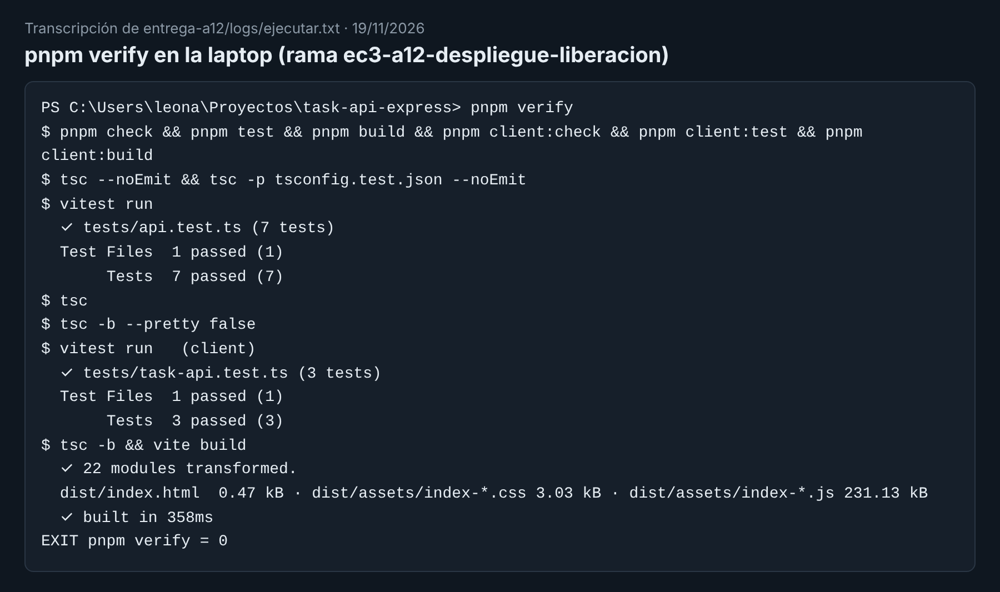

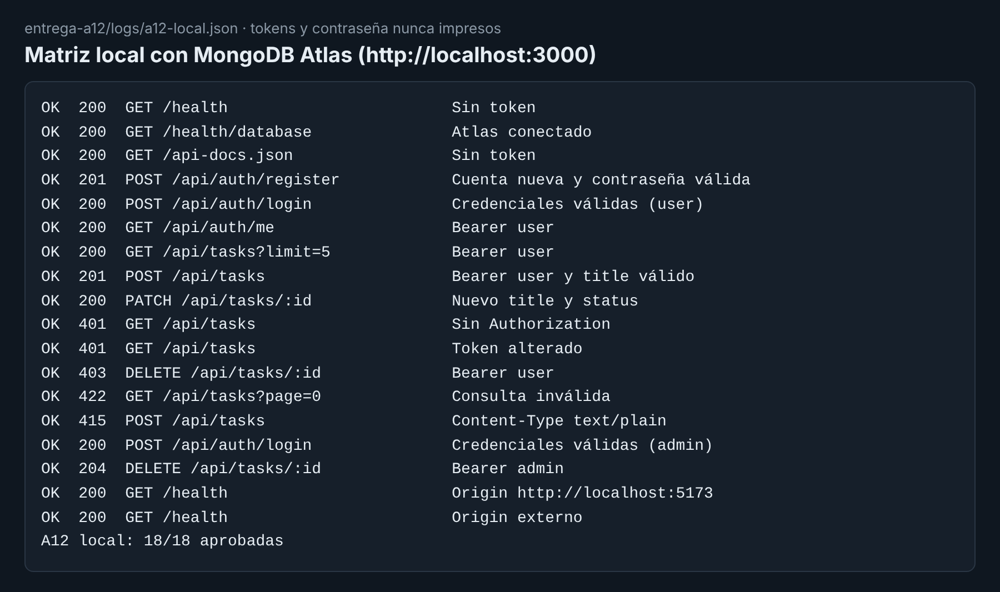

Matriz local detallada

| # | Tipo | Método y ruta | Datos o condición | Esperado | Obtenido | Código | requestId | Resultado |
|---|---|---|---|---|---|---|---|---|
| 1 | Positiva | `GET /health` | Sin token | 200 | 200 | — | `862a046a` | Aprobada |
| 2 | Regresión | `GET /health/database` | Atlas conectado | 200 | 200 | — | `c7ac8d0b` | Aprobada |
| 3 | Regresión | `GET /api-docs.json` | Sin token | 200 | 200 | — | `4d98f618` | Aprobada |
| 4 | Positiva | `POST /api/auth/register` | Cuenta nueva y contraseña válida | 201 | 201 | — | `ea81f281` | Aprobada |
| 5 | Positiva | `POST /api/auth/login` | Credenciales válidas (user) | 200 | 200 | — | `e27ae4bb` | Aprobada |
| 6 | Positiva | `GET /api/auth/me` | Bearer user | 200 | 200 | — | `6cec1b8d` | Aprobada |
| 7 | Positiva | `GET /api/tasks?limit=5` | Bearer user | 200 | 200 | — | `4c43be63` | Aprobada |
| 8 | Positiva | `POST /api/tasks` | Bearer user y title válido | 201 | 201 | — | `004f6d33` | Aprobada |
| 9 | Positiva | `PATCH /api/tasks/:id` | Nuevo title y status | 200 | 200 | — | `d18f38c5` | Aprobada |
| 10 | Negativa | `GET /api/tasks` | Sin Authorization | 401 | 401 | AUTHENTICATION_REQUIRED | `ad40dd97` | Aprobada |
| 11 | Negativa | `GET /api/tasks` | Token alterado | 401 | 401 | INVALID_TOKEN | `680a5d62` | Aprobada |
| 12 | Negativa | `DELETE /api/tasks/:id` | Bearer user | 403 | 403 | FORBIDDEN | `692f0d72` | Aprobada |
| 13 | Negativa | `GET /api/tasks?page=0` | Consulta inválida | 422 | 422 | QUERY_VALIDATION_ERROR | `e3e10dd7` | Aprobada |
| 14 | Negativa | `POST /api/tasks` | Content-Type text/plain | 415 | 415 | UNSUPPORTED_MEDIA_TYPE | `4193d51d` | Aprobada |
| 15 | Positiva | `POST /api/auth/login` | Credenciales válidas (admin) | 200 | 200 | — | `2b6db72a` | Aprobada |
| 16 | Positiva | `DELETE /api/tasks/:id` | Bearer admin | 204 | 204 | — | `1664b90e` | Aprobada |
| 17 | CORS | `GET /health` | Origin http://localhost:5173 | 200 | 200 | — | `a1f86077` | Aprobada |
| 18 | Regresión | `GET /health` | Origin externo | 200 | 200 | — | `60d02d70` | Aprobada |

## Despliegue

- **Blueprint:** `task-api-express-a12`, creado desde `render.yaml` de la rama `ec3-a12-despliegue-liberacion`. Crea el servicio Node `task-api-express-leonardo0973` (plan free, región Oregon, health check `/health/database`) y el sitio estático `task-client-react-leonardo0973` (reescritura SPA `/*` → `/index.html`).
- **Variables sensibles:** `PUBLIC_API_URL`, `CORS_ORIGIN` y `VITE_API_URL` se capturaron en Render (URLs HTTPS públicas); `MONGODB_URI` la pegó el alumno directamente en Render; `JWT_SECRET` lo generó Render (`generateValue`). Ninguna está en Git.
- **Estado de /health:** 200 `{ "status": "up", "version": "1.0.0", "environment": "production" }`.
- **Estado de /health/database:** 200 `{ "status": "up", "database": "task_api", "ping": "ok" }`.
- **OpenAPI usa la URL pública:** sí. Swagger UI muestra el servidor `https://task-api-express-leonardo0973.onrender.com - Entorno de producción` y *Try it out* llamó a esa URL.
- **Atlas restringido a IP de salida:** sí. Se agregaron los rangos de salida de Render `74.220.48.0/24` y `74.220.56.0/24` y se eliminó la regla `0.0.0.0/0`. Siguen solo las IP de la computadora del alumno para desarrollo local.

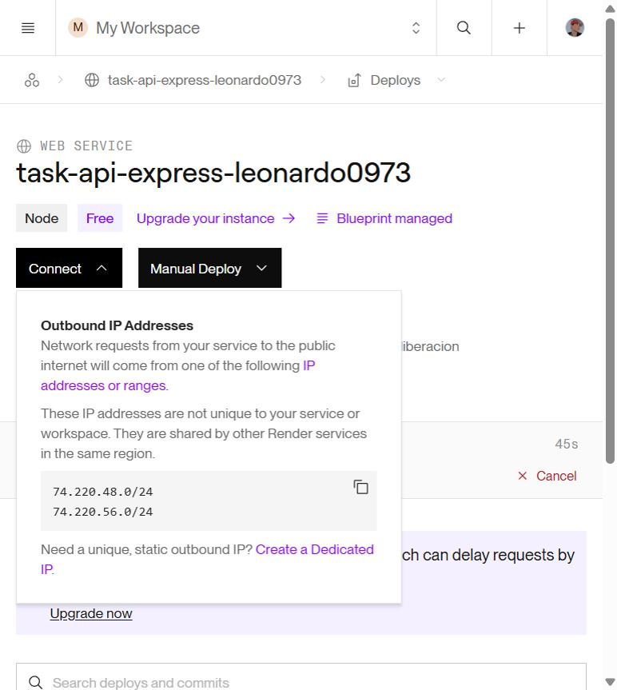

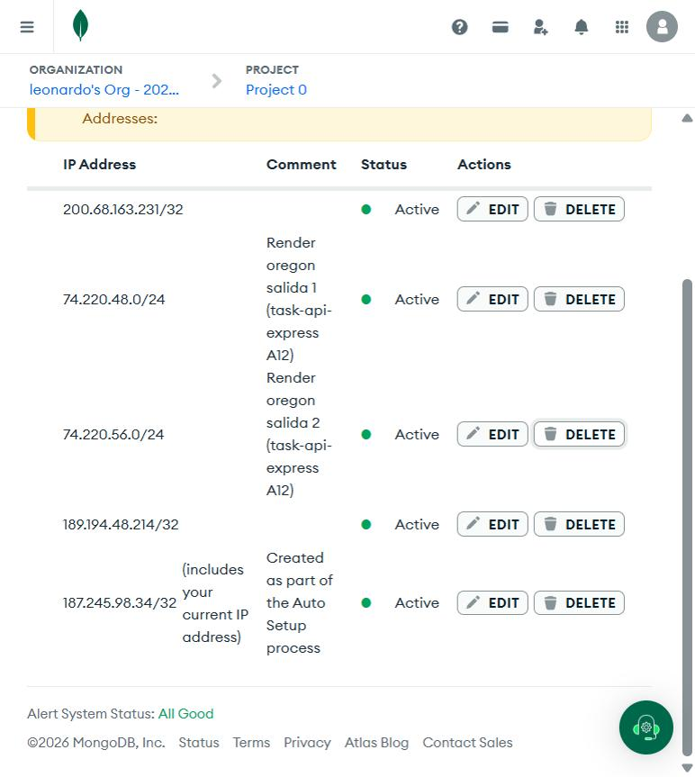

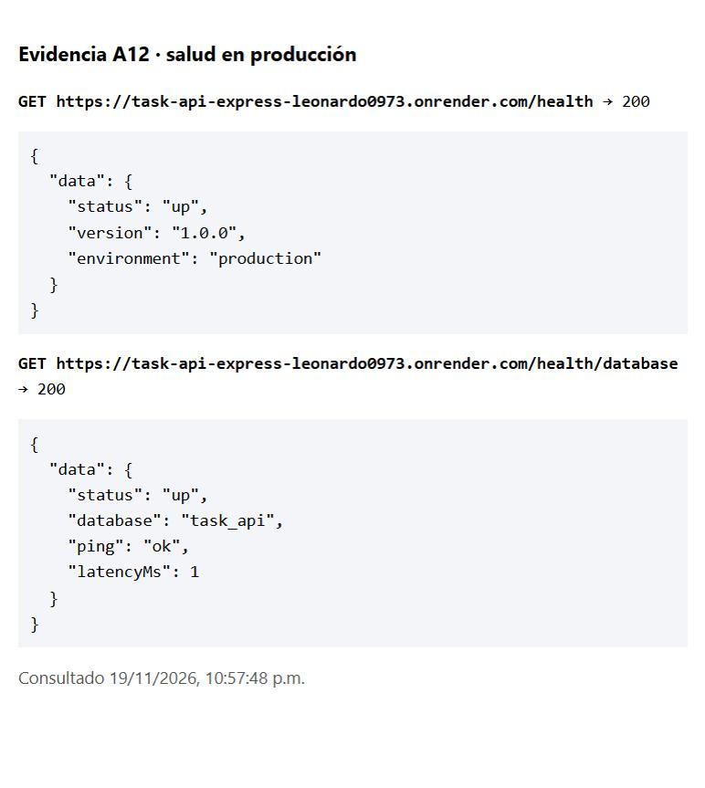

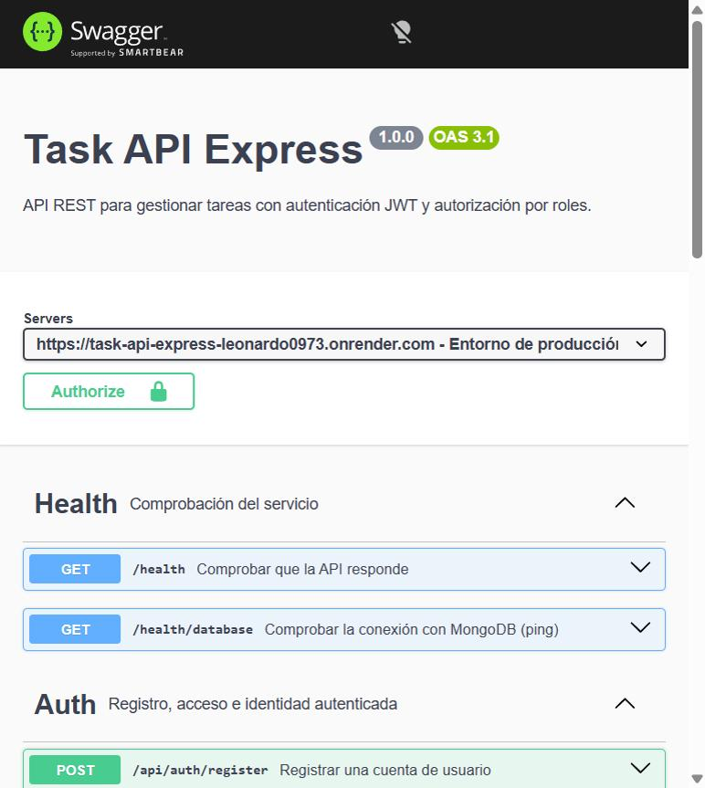

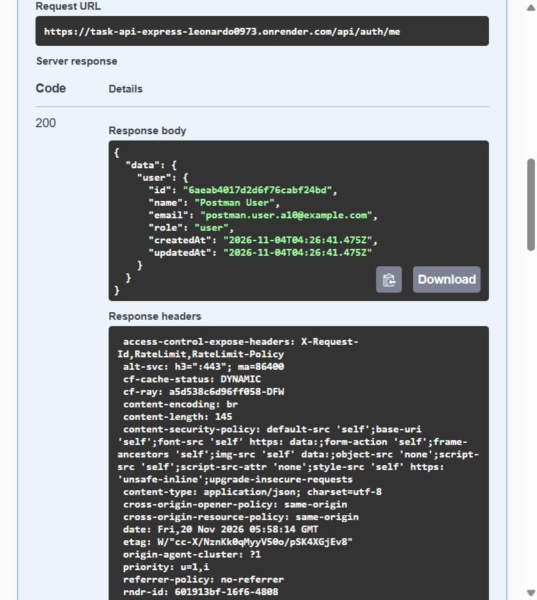

## Aceptación

| Caso | Código o resultado | Evidencia | Observación |
|---|---|---|---|
| Registro | 201 (API) y cuenta creada desde React | Matriz producción fila 4; React con "Crear cuenta" | Usuario nuevo con rol `user`, sin `passwordHash`. El registro en React inició la sesión automáticamente. |
| Login y /me | 200 y 200 | Matriz filas 5–6; capturas 07 y 08 | `tokenType: Bearer`; token nunca impreso. React muestra nombre, correo (oculto en la captura) y rol. |
| Crear tarea | 201 | Matriz fila 8; captura 08 | Desde React: "Preparar exposición A12" (alta) y "Revisar despliegue en Render" (baja). |
| Filtrar y paginar | 200 | Capturas 09 y 11 | Búsqueda `A12` + Pendientes + Título ascendente → 1 resultado; paginación "Página 2 de 5". |
| Editar y completar | 200 | Matriz fila 9; captura 10 | Título → "Preparar exposición final A12", completar y reabrir con `PATCH`. |
| DELETE con user | 403 `FORBIDDEN` | Matriz fila 12; captura 08 | El botón Eliminar no aparece para `user` y la API también lo impide. |
| DELETE con admin | 204 | Matriz fila 16; capturas 14 y 15 | `postman.admin.a10` eliminó "Revisar despliegue en Render" desde React (total 21 → 20). |
| Token inválido | 401 `INVALID_TOKEN` | Matriz fila 11 | Sin token: 401 `AUTHENTICATION_REQUIRED`. Ninguna respuesta incluye stack trace. |
| Prueba de humo | Salida 0 | Captura 13 | Cinco comprobaciones aprobadas sin imprimir contraseña ni token. |

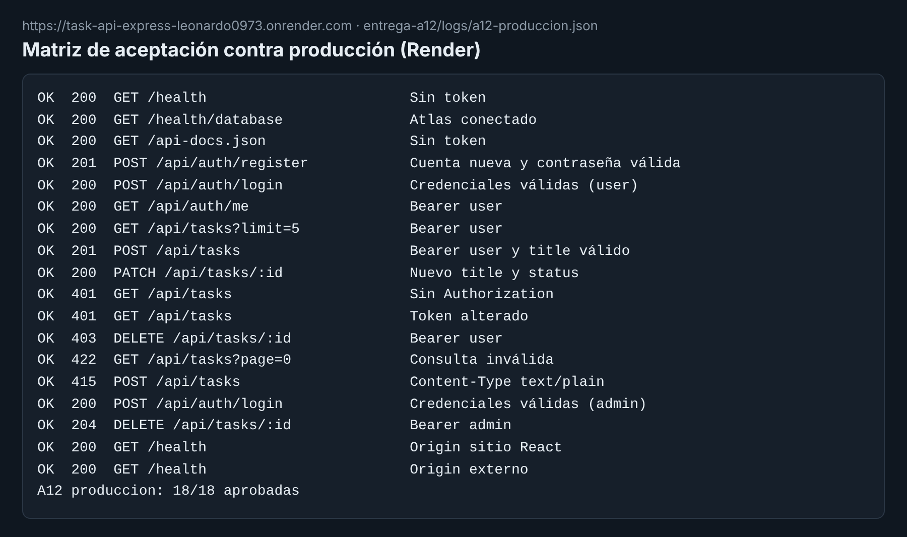

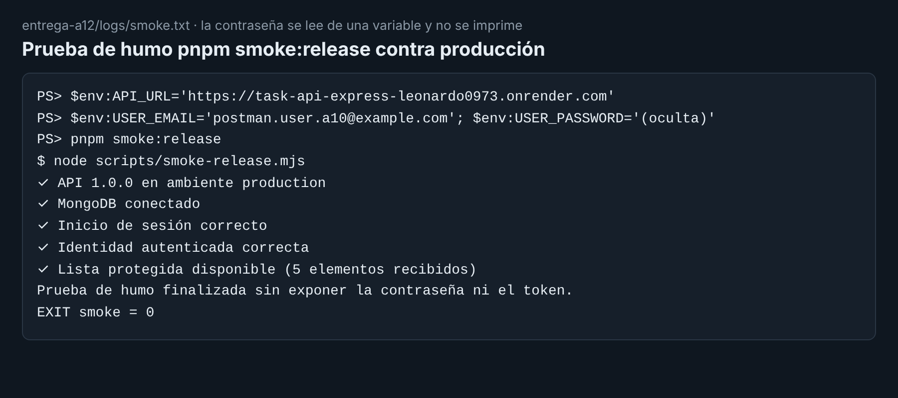

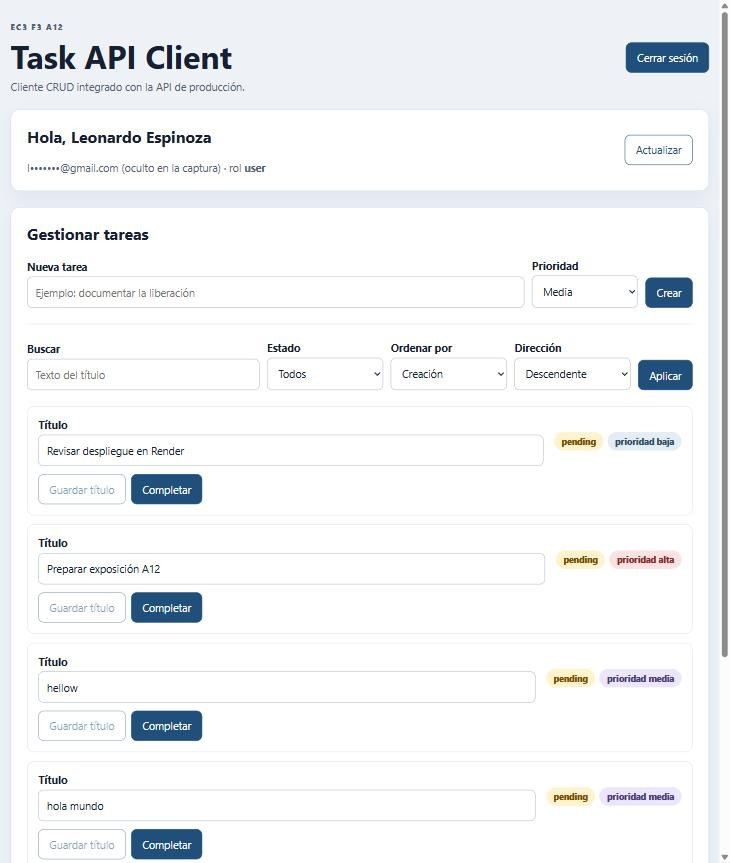

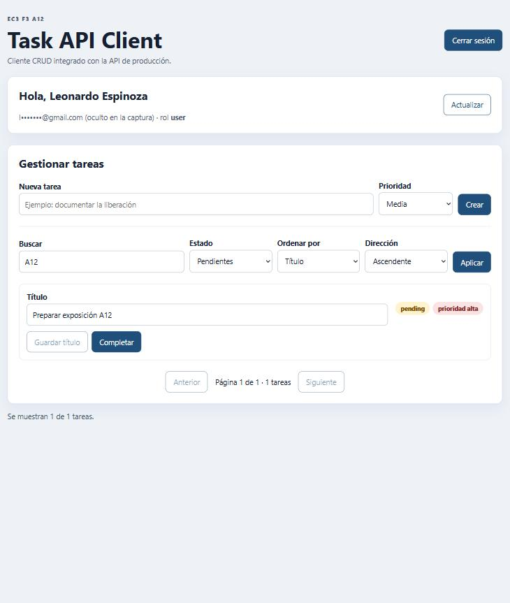

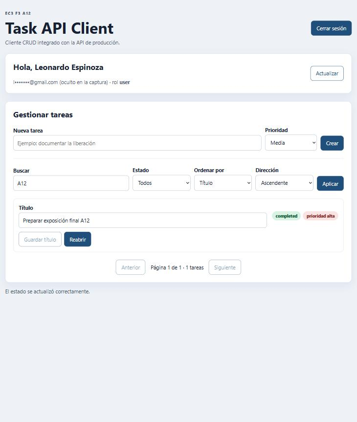

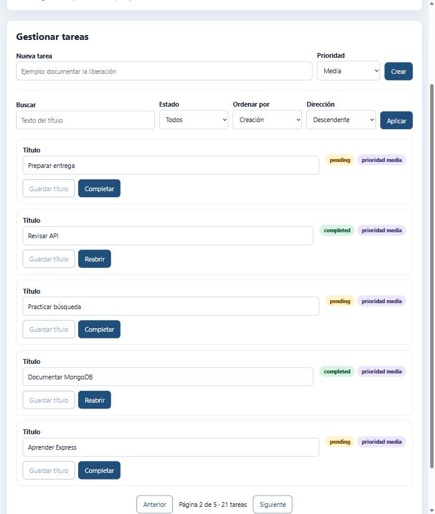

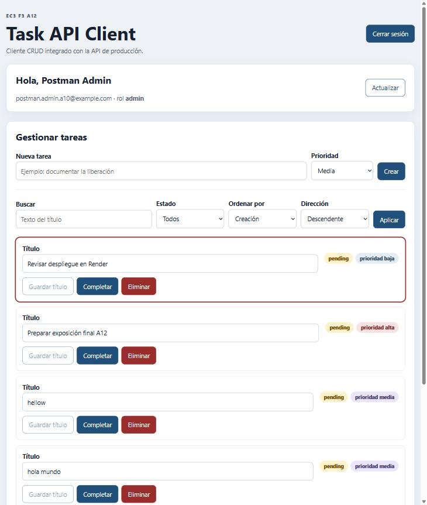

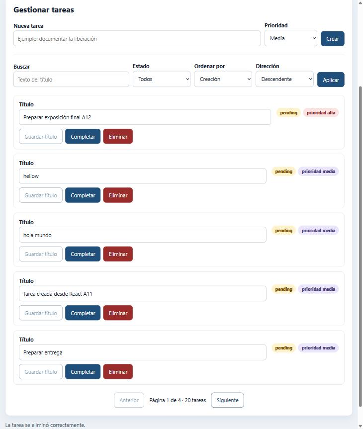

Matriz de producción detallada

| # | Tipo | Método y ruta | Datos o condición | Esperado | Obtenido | Código | requestId | Resultado |
|---|---|---|---|---|---|---|---|---|
| 1 | Positiva | `GET /health` | Sin token | 200 | 200 | — | `18cb6e4a` | Aprobada |
| 2 | Regresión | `GET /health/database` | Atlas conectado | 200 | 200 | — | `dd05f032` | Aprobada |
| 3 | Regresión | `GET /api-docs.json` | Sin token | 200 | 200 | — | `8035e308` | Aprobada |
| 4 | Positiva | `POST /api/auth/register` | Cuenta nueva y contraseña válida | 201 | 201 | — | `decaa773` | Aprobada |
| 5 | Positiva | `POST /api/auth/login` | Credenciales válidas (user) | 200 | 200 | — | `c4e0632d` | Aprobada |
| 6 | Positiva | `GET /api/auth/me` | Bearer user | 200 | 200 | — | `907f858b` | Aprobada |
| 7 | Positiva | `GET /api/tasks?limit=5` | Bearer user | 200 | 200 | — | `86730987` | Aprobada |
| 8 | Positiva | `POST /api/tasks` | Bearer user y title válido | 201 | 201 | — | `7589f4c4` | Aprobada |
| 9 | Positiva | `PATCH /api/tasks/:id` | Nuevo title y status | 200 | 200 | — | `203b58ec` | Aprobada |
| 10 | Negativa | `GET /api/tasks` | Sin Authorization | 401 | 401 | AUTHENTICATION_REQUIRED | `713a2359` | Aprobada |
| 11 | Negativa | `GET /api/tasks` | Token alterado | 401 | 401 | INVALID_TOKEN | `5af59acb` | Aprobada |
| 12 | Negativa | `DELETE /api/tasks/:id` | Bearer user | 403 | 403 | FORBIDDEN | `ebf5fc71` | Aprobada |
| 13 | Negativa | `GET /api/tasks?page=0` | Consulta inválida | 422 | 422 | QUERY_VALIDATION_ERROR | `7854099f` | Aprobada |
| 14 | Negativa | `POST /api/tasks` | Content-Type text/plain | 415 | 415 | UNSUPPORTED_MEDIA_TYPE | `4514689d` | Aprobada |
| 15 | Positiva | `POST /api/auth/login` | Credenciales válidas (admin) | 200 | 200 | — | `77fc1d57` | Aprobada |
| 16 | Positiva | `DELETE /api/tasks/:id` | Bearer admin | 204 | 204 | — | `32d0c3c6` | Aprobada |
| 17 | CORS | `GET /health` | Origin sitio React | 200 | 200 | — | `a7c8ea3b` | Aprobada |
| 18 | Regresión | `GET /health` | Origin externo | 200 | 200 | — | `e5f5fddd` | Aprobada |

## Seguridad de la evidencia

- [x] No se muestra MONGODB_URI.
- [x] No se muestra JWT_SECRET.
- [x] No se muestran contraseñas.
- [x] Los tokens están ocultos o truncados (bloque cURL de Swagger oculto; los scripts no imprimen tokens; los `requestId` se recortan a 8 caracteres).

## Incidencias y solución

1. **Incidencia:** la primera ejecución del script se detuvo esperando la API local.
   **Causa:** la API ahora escucha en `0.0.0.0` (IPv4) y en Windows `localhost` prueba primero IPv6 (`::1`), así que `Invoke-WebRequest` agotaba el tiempo.
   **Corrección:** el script comprueba `http://127.0.0.1:3000`; la matriz local también usa 127.0.0.1 y valida que OpenAPI anuncie `http://localhost:3000`.
   **Nueva comprobación:** matriz local 18/18.
2. **Incidencia:** Render rechazó el Blueprint: "max shutdown delay is not supported for free tier services".
   **Causa:** `maxShutdownDelaySeconds` solo existe en planes de pago.
   **Corrección:** se quitó de `render.yaml` (commit `5244373`); el cierre ordenado con SIGTERM sigue en `graceful-shutdown.ts`.
   **Nueva comprobación:** el Blueprint se creó y los dos servicios desplegaron `5244373`.
3. **Incidencia:** Render no tenía permiso de GitHub sobre el repositorio.
   **Causa:** la app de GitHub de Render no tiene acceso a `task-api-express`.
   **Corrección:** el Blueprint se creó desde la URL pública del repositorio; los despliegues se lanzan manualmente o al sincronizar el Blueprint.
   **Nueva comprobación:** despliegue correcto; los commits posteriores llevan `[skip render]` para que producción siga en `v1.0.0`.
4. **Incidencia:** la lista de acceso de Atlas tenía `0.0.0.0/0` abierto.
   **Causa:** regla de una práctica anterior con Render.
   **Corrección:** se reemplazó por los rangos de salida del servicio.
   **Nueva comprobación:** `/health/database` 200 `up` y matriz de producción 18/18.

## Desafío individual

Vista de detalle de tarea con React Router (`react-router` 7.18.5, instalado solo en `client`).

- **Ruta** `/tasks/:id` (`client/src/components/TaskDetail.tsx`), con enlace **Ver detalle** en cada tarea y enlace **← Volver a la lista**.
- **Fuente de verdad:** consulta `GET /api/tasks/:id` con el token Bearer (`client/src/task-detail.ts`); no reutiliza el arreglo de la lista.
- **Estados:** carga, tarea encontrada (estado, prioridad, fechas e id), 401 (cierra la sesión y vuelve al acceso), 404 y 400 (identificador inválido), con el `requestId` en los mensajes de error.
- **Recarga directa:** la reescritura SPA de `render.yaml` (`/*` → `/index.html`) y el servidor de Vite sirven `index.html`, así que recargar `/tasks/:id` no da 404.
- **Pruebas:** `client/tests/task-detail.test.ts` agrega 3 pruebas (200 con Bearer y URL correcta, 404 con `requestId`, 401 como sesión no válida). `pnpm verify` continúa aprobado con 7 pruebas backend y 6 de cliente.
- **Liberación:** el cambio está en un commit posterior a `v1.0.0` con `[skip render]` y se documenta en `CHANGELOG.md` → *Unreleased*, así que producción sigue siendo exactamente la versión 1.0.0 etiquetada.

Reflexión: [reflexion-a12.md](reflexion-a12.md) · Lista de liberación: [release-checklist.md](release-checklist.md)
