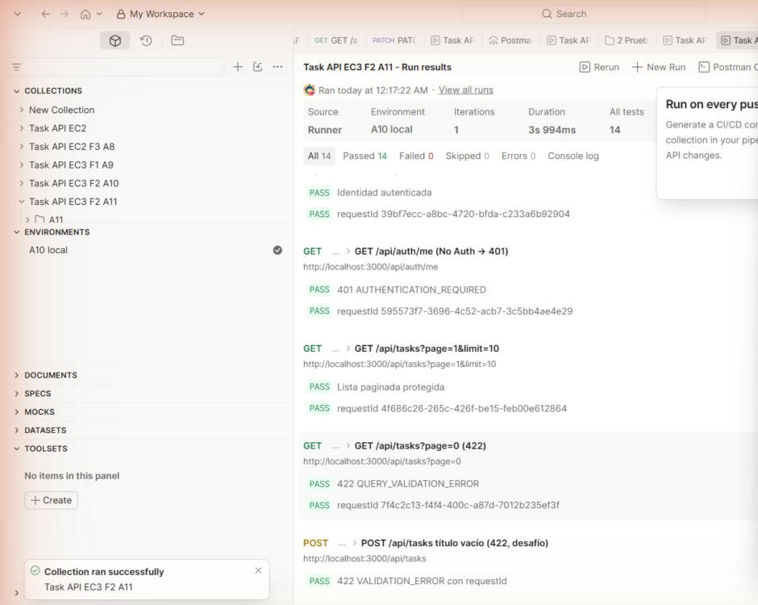
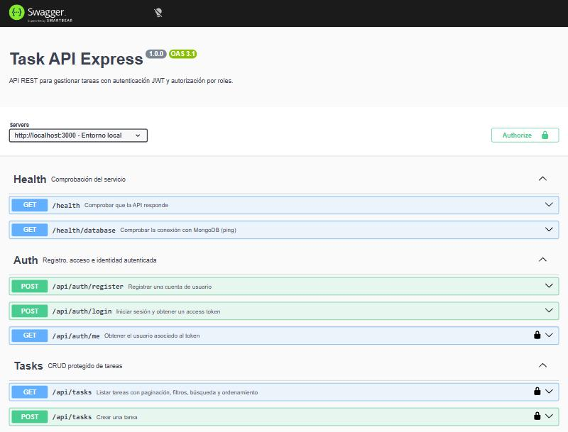
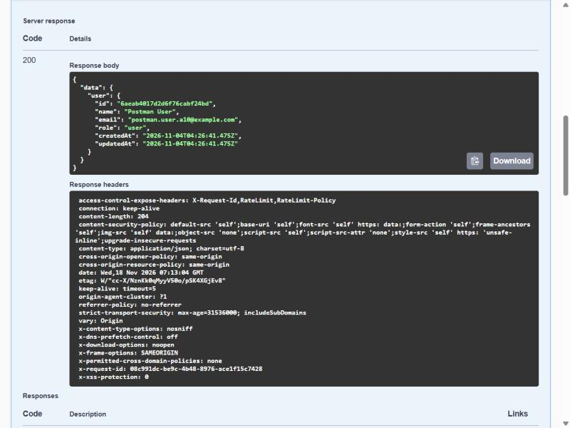
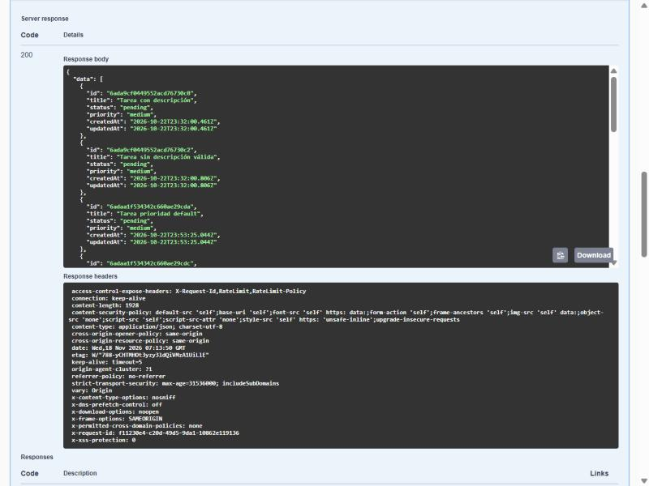
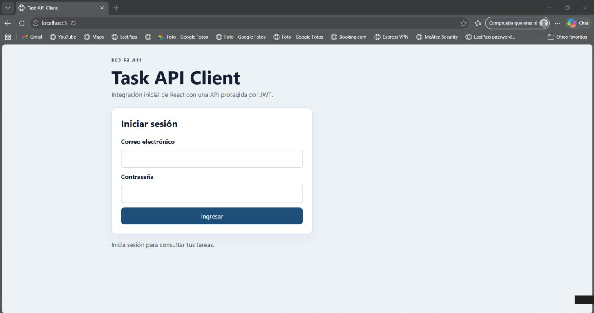
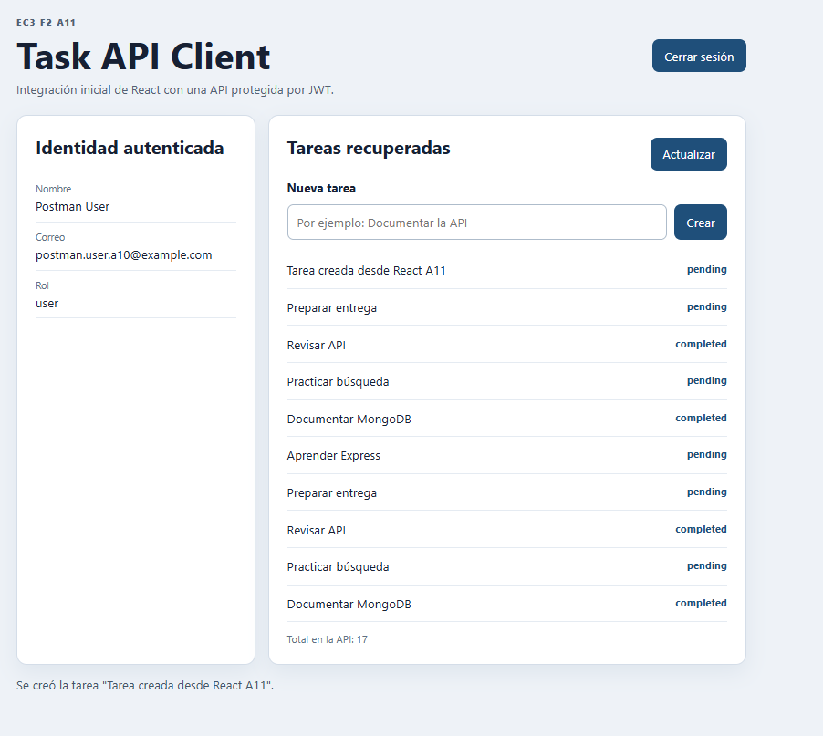

# Evidencias EC3 F2 A11: pruebas, OpenAPI e integración con React

**Proyecto:** task-api-express · **Rama:** `ec3-a11-calidad-integracion` (creada desde `ec3-a11-me-usuario`, que contiene el commit final de A10) · **Fecha:** 18 de noviembre de 2026

## 1. Resumen

| Parte | Resultado |
|---|---|
| Pruebas automatizadas (`pnpm test`, Vitest + SuperTest) | 7/7 aprobadas, sin conexión a Atlas |
| `pnpm verify` (check, test, build, client:check, client:build) | Código de salida 0 |
| Matriz manual contra MongoDB Atlas | 19/19 aprobadas |
| Postman Runner, colección `Task API EC3 F2 A11` con entorno `A10 local` | 14/14 pruebas aprobadas |
| Swagger UI en `/api-docs` | `GET /api/auth/me` y `GET /api/tasks` respondieron 200 con Authorize |
| Cliente React (`client/`, Vite) en `http://localhost:5173` | Login, identidad, lista y creación de tarea desde el formulario |
| Desafío individual | Formulario **Nueva tarea** en React y su prueba automatizada |

## 2. Cambios en la API

- **`GET /api/auth/me`**: requiere Bearer; el id sale del JWT verificado (`res.locals.auth.userId`), no de params ni del cuerpo. `auth.service.getAuthenticatedUser` consulta la cuenta y responde `{ data: { user } }` sin `passwordHash`. Si la cuenta ya no existe responde 401 `AUTHENTICATED_USER_NOT_FOUND`.
- **Rate limit**: `authRateLimiter` se aplica solo a `POST /register` y `POST /login`. En la prueba, 15 consultas seguidas a `/me` respondieron 200.
- **OpenAPI 3.1** en `src/docs/openapi.ts`, publicado en `GET /api-docs.json`. **Swagger UI** en `/api-docs`, con Helmet sin CSP solo en esas dos rutas; el resto de la API mantiene la CSP de A10.
- **Pruebas**: `vitest.config.ts`, `tests/setup-env.ts` (variables de prueba sin secretos reales) y `tests/api.test.ts`.
- **Cliente React** en `client/` dentro del workspace de pnpm.

## 3. Pruebas automatizadas (Vitest + SuperTest)

En `tests/api.test.ts` solo `auth.service` y `task.service` se reemplazan con dobles (`vi.mock` + `vi.hoisted`). Rutas, middleware, validación, `authenticate`, `requireRole`, `token.service` (JWT reales) y `errorHandler` son reales. SuperTest envía las solicitudes a `app` sin abrir un puerto.

| # | Grupo | Prueba | Resultado |
|---|---|---|---|
| 1 | Documentación | `/health` con Helmet y `X-Request-Id`; `/api-docs.json` es 3.1.0 con `bearerAuth`; `/api-docs/` devuelve el HTML de Swagger UI | Aprobada |
| 2 | Autenticación | Registro 201 sin hash, login con `tokenType: Bearer` y `/me` con `data.user` | Aprobada |
| 3 | Autenticación | `/me` y `/api/tasks` sin token responden 401 `AUTHENTICATION_REQUIRED` | Aprobada |
| 4 | CRUD | El listado envía al servicio la consulta validada; `POST /api/tasks` responde 201 | Aprobada |
| 5 | Autorización | `DELETE` con user responde 403 y no llama al servicio; con admin responde 204 | Aprobada |
| 6 | Regresión | `page=0` responde 422 con `requestId`; CORS permite `localhost:5173` y no un origen ajeno | Aprobada |
| 7 | **Desafío** | Título vacío responde 422 `VALIDATION_ERROR` en `details[0].field = title` sin llamar al servicio; sin token responde 401 | Aprobada |

```
Test Files  1 passed (1)
     Tests  7 passed (7)
EXIT pnpm verify = 0
```

## 4. Matriz manual contra MongoDB Atlas

La ejecutó `entrega-a11/a11-tests.mjs` con la API real (`node dist/server.js`) conectada a Atlas. Los tokens solo vivieron en memoria; aquí se muestran solo los primeros 8 caracteres de cada `requestId`.

| # | Tipo | Ruta | Datos | Esperado | Obtenido | Código | requestId | Resultado | Observación |
|---|---|---|---|---|---|---|---|---|---|
| 1 | Positiva | `GET /health` | Sin token | 200 | 200 | — | `78ae81ae` | Aprobada | status ok; CSP presente |
| 2 | Positiva | `GET /health/database` | Sin token | 200 | 200 | — | `e83be6a0` | Aprobada | status ok, ping ok, base task_api |
| 3 | Documentación | `GET /api-docs.json` | Sin token | 200 | 200 | — | `16eaf053` | Aprobada | openapi 3.1.0; 8 rutas; bearerAuth bearer |
| 4 | Documentación | `GET /api-docs/` | Sin token | 200 | 200 | — | `6542ef94` | Aprobada | HTML de Swagger UI; CSP desactivada solo aquí; nosniff nosniff |
| 5 | Positiva | `POST /api/auth/login` | Correo y contraseña (user) | 200 | 200 | — | `85b948fd` | Aprobada | devuelve accessToken (no se guarda) |
| 6 | Negativa | `GET /api/auth/me` | Sin token | 401 | 401 | AUTHENTICATION_REQUIRED | `d267f993` | Aprobada | — |
| 7 | Positiva | `GET /api/auth/me` | Bearer user | 200 | 200 | — | `063c76cb` | Aprobada | campos id, name, email, role, createdAt, updatedAt; role user; sin passwordHash true |
| 8 | Negativa | `GET /api/auth/me` | Bearer inválido | 401 | 401 | INVALID_TOKEN | `363f1c6b` | Aprobada | — |
| 9 | Negativa | `GET /api/tasks` | Sin token | 401 | 401 | AUTHENTICATION_REQUIRED | `1a6cac01` | Aprobada | contrato uniforme con requestId |
| 10 | Positiva | `POST /api/tasks` | Bearer user y title | 201 | 201 | — | `72677e3f` | Aprobada | id 6afd4fa9110b7e6c03e2aa74 |
| 11 | Regresión | `GET /api/tasks?page=1&limit=10&status=pending&search=A11&sortBy=title&order=asc` | Bearer user y filtros | 200 | 200 | — | `7d420d60` | Aprobada | data 1; meta.total 1 |
| 12 | Autorización | `DELETE /api/tasks/:id` | Bearer user | 403 | 403 | FORBIDDEN | `62313301` | Aprobada | — |
| 13 | Positiva | `POST /api/auth/login` | Correo y contraseña (admin) | 200 | 200 | — | `6535ca66` | Aprobada | role admin |
| 14 | Autorización | `DELETE /api/tasks/:id` | Bearer admin | 204 | 204 | — | `571ad120` | Aprobada | sin cuerpo |
| 15 | Negativa | `GET /api/tasks?page=0` | Bearer válido | 422 | 422 | QUERY_VALIDATION_ERROR | `42c8b20e` | Aprobada | — |
| 16 | Desafío | `POST /api/tasks` | Bearer user y título vacío | 422 | 422 | VALIDATION_ERROR | `a5331991` | Aprobada | error uniforme que muestra React |
| 17 | Regresión | `GET /api/auth/me ×15` | Bearer user | 200 | 200 | — | `1ddb6a6d` | Aprobada | 15/15 respondieron 200 (el limitador solo cubre register y login) |
| 18 | CORS | `GET /health` | Origin http://localhost:5173 | 200 | 200 | — | `8fb2e8e5` | Aprobada | Access-Control-Allow-Origin http://localhost:5173 |
| 19 | CORS | `GET /health` | Origin https://no-autorizado.example | 200 | 200 | — | `292b5d47` | Aprobada | sin Access-Control-Allow-Origin |

## 5. Postman

Colección `postman/Task API EC3 F2 A11.postman_collection.json` (8 solicitudes) con el entorno `A10 local`. El login guarda `userToken` solo en el entorno local. Runner: **14 pruebas, 14 aprobadas, 0 fallidas**.



## 6. Swagger UI

`http://localhost:3000/api-docs` muestra las rutas Health, Auth y Tasks. Las rutas protegidas tienen candado y se autorizan con el `accessToken` en **Authorize**. Las capturas no muestran el token: se ocultó el bloque cURL.







## 7. Cliente React

`client/` (React 19 + Vite + TypeScript) usa `VITE_API_URL=http://localhost:3000` (`client/.env.example`). El cliente:

- Inicia sesión con `POST /api/auth/login` y guarda el token en `sessionStorage`.
- Consulta `GET /api/auth/me` y `GET /api/tasks?limit=10&sortBy=createdAt&order=desc` con `Authorization: Bearer`.
- Ante un 401 borra la sesión local y vuelve al login. Ante otros errores muestra el mensaje y el `requestId`.
- El navegador pudo leer las respuestas porque la API devolvió `Access-Control-Allow-Origin: http://localhost:5173`.

Prueba en Microsoft Edge con la API conectada a Atlas: inicio de sesión con la cuenta `user`, identidad autenticada (nombre, correo y rol), lista de tareas (total 17 en la API) y creación de **"Tarea creada desde React A11"** desde el formulario del desafío. La tarea aparece primero sin recargar y el mensaje de estado confirma la creación. Se comprobó en Atlas con `GET /api/tasks?search=React` (`createdAt` 2026-11-18T07:25:45Z).

> El panel de navegador integrado de Claude bloquea peticiones de `localhost:5173` a `localhost:3000` (`net::ERR_BLOCKED_BY_CLIENT`). Es una restricción de ese panel, no de CORS, así que la prueba se hizo en Edge.





## 8. Desafío individual: crear tareas desde React

- **Interfaz**: formulario **Nueva tarea** en `client/src/App.tsx`. Valida en el cliente el título vacío y el máximo de 120 caracteres, envía `POST /api/tasks` con Bearer y agrega la tarea creada (201) al inicio de la lista sin recargar. Si la API responde con error, muestra el mensaje con su `requestId`; ante un 401 cierra la sesión.
- **Prueba automatizada**: `desafío: crear tarea desde el cliente` en `tests/api.test.ts` comprueba que la API rechaza un título vacío con 422 `VALIDATION_ERROR` sin llegar al servicio, y que sin token responde 401.
- **Comprobación manual**: con Atlas, `POST /api/tasks` respondió 201 y el título vacío 422 (filas 10 y 16 de la matriz); en Postman pasó la solicitud *título vacío (422, desafío)*.

## 9. Commits

```
a04f5d8 test: configura pruebas automatizadas de la API
cf79154 feat: agrega consulta de identidad autenticada
50b38b1 docs: publica contrato OpenAPI y Swagger UI
149fe54 test: cubre autenticacion autorizacion y regresion
1200a62 feat: integra cliente React con la API protegida
        docs: registra evidencias de la actividad 11
```

## 10. Seguridad de la evidencia

- `.env`, `client/.env`, `node_modules`, `dist` y `entrega-a11/` no se suben (`.gitignore`). Antes del push el script busca en los archivos versionados cadenas de conexión `mongodb+srv://` con credenciales y tokens JWT (`eyJhbGciOi`).
- Ninguna captura ni documento muestra tokens, la URI de Atlas ni el secreto JWT.

Reflexión: [ec3-a11-reflexion.md](ec3-a11-reflexion.md).
